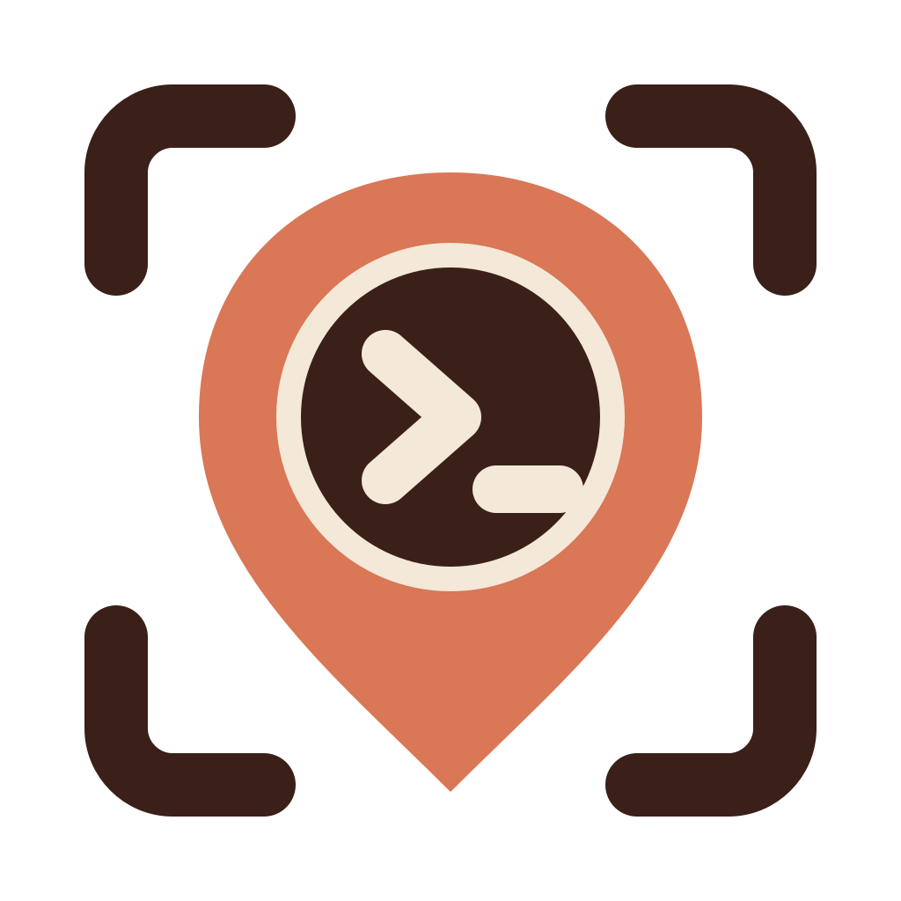

<div align="center">



# P I N P O I N T

### Comment on the page. Fix it in the terminal.

Pin comments to elements on your localhost app. Hit Dispatch. Claude Code receives the
element, the page state, and a screenshot of exactly what you saw.

[Website](https://tolgainam.github.io/pinpoint/) · [Install](#install) · [How it works](#how-it-works)

</div>

**Where it works:** in Claude Code, on your own computer (terminal, IDE extension or the
desktop app's Code tab). It needs a local bridge and a browser on the same machine, so it does
not run in claude.ai chat or in the Claude mobile apps. Browsers: Chrome and other Chromium
browsers, Firefox 128+, Opera.

---

Reviewing a running app and getting fixes made is a lossy loop. You spot something wrong
in the browser, then describe it in prose — *"the spacing under the brand header on the
explore page is too tight"* — and Claude has to reconstruct which element you meant. The
context that was obvious on screen never survives the trip.

Pinpoint closes that loop. Click an element, type what's wrong, dispatch. What arrives in
your session is a CSS selector, the component name, the visible text, the bounding box,
the page URL and colour scheme, and a cropped PNG of the element itself.

It runs in both directions. Claude Code answers a question you ask on a pin (start the note
with `?`), keeps a backlog for later (start it with `!`), and marks a comment done when the fix
lands, so the pin turns green. That is possible because Pinpoint is built on Claude Code's
channels, a live link into a running session, which is why it works with Claude Code only.
Channels are a research preview, so Claude Code needs one extra flag (see
[Install](#install)). Without it nothing is lost: run `/pinpoint:comments` and every
dispatched comment is there.

```
browser overlay ──POST /dispatch──▶ bridge ──▶ queue on disk (json + PNGs)
                                      │
                                      ├──▶ channel event   → lands in your session
                                      └──▶ list_comments   → /pinpoint:comments
```

## Install

Two pieces: a Claude Code plugin, and a browser extension. Requires Node 20+ and Chrome, a
Chromium browser or Firefox 128+.
Nothing else: dependencies install themselves with the plugin.

1. **Add the marketplace and install the plugin**, in any Claude Code session:

   ```
   /plugin marketplace add tolgainam/pinpoint
   /plugin install pinpoint@pinpoint-marketplace
   ```

   Or from a terminal, with npm, pnpm or yarn (it runs the two commands above for you):

   ```bash
   npx pinpoint-dev install
   ```

2. **Start Claude Code with channels on** (restart the session you were in):

   ```bash
   claude --dangerously-load-development-channels plugin:pinpoint@pinpoint-marketplace
   ```

   This is what lets a dispatched comment appear in your session on its own. Channels are
   a research preview and custom ones are not on Anthropic's allowlist yet, so the flag is
   required and Claude Code shows a full-screen warning at startup: choose **I am using
   this for local development**. Skip it and nothing breaks: comments wait in the queue
   until you run `/pinpoint:comments`.

3. **Add the browser extension.** Use your browser's store: the Chrome Web Store (Chrome,
   Edge, Brave, Arc, Vivaldi), Mozilla Add-ons (Firefox 128+) or Opera add-ons. The links are on
   [the website](https://tolgainam.github.io/pinpoint/). Until a listing is live for your
   browser, load it from a folder (next step).

4. **Run setup.** It checks that everything is connected, and it copies the extension for
   loading from a folder:

   ```
   /pinpoint:setup
   ```

   It copies the extension to `~/.claude/pinpoint/extension`, puts that path on your
   clipboard and opens `chrome://extensions`.

   **Loading from a folder** (developers, or until a listing is live): turn on **Developer
   mode** (top right), click **Load unpacked**, paste the path and select the folder.
   "Unpacked" means Chrome runs the extension straight from that folder, so don't move or
   delete it.

5. **Pin the icon:** the puzzle piece in the toolbar, then the pin next to Pinpoint. A welcome
   tab opens once on install with the same steps.

6. **Open your dev app on `localhost` and click the Pinpoint icon.** The toolbar starts
   hidden in a new tab. Once you show it, it stays open in that tab, through reloads, until
   you close it with ✕ or the icon. On any other site, such as a staging
   server, the same click asks your browser for that one site.

Setup ends with the same checks as `/pinpoint:doctor`, each failure with its fix.

**You're done when:** the icon is pinned, clicking it on your dev page shows the toolbar,
and the pill shows your project name.

### Other browsers

The extension is Manifest V3 and uses no Chrome-only API, so it runs in any Chromium
browser and in Firefox.

| Browser | How to load it | Notes |
|---|---|---|
| Chrome, Edge, Brave, Opera, Vivaldi, Arc | Same steps as above. `npx pinpoint-dev setup` does what `/pinpoint:setup` does. Open the browser's own extensions page (`edge://extensions`, `brave://extensions`, ...) | `/pinpoint:setup` opens Chrome; open the other page yourself and paste the same path |
| Firefox 128+ | `/pinpoint:setup --firefox`, then `about:debugging#/runtime/this-firefox`, **Load Temporary Add-on**, pick `manifest.json` | Firefox removes a temporary add-on when it quits. Allow localhost access under `about:addons` > Pinpoint > Permissions |
| Safari | Not supported yet | Needs `xcrun safari-web-extension-converter` and an Xcode build |

**A permanent Firefox install** needs a signed add-on, because release Firefox refuses
unsigned ones. Get an API key and secret from
[addons.mozilla.org/developers/addon/api/key](https://addons.mozilla.org/developers/addon/api/key/),
put them in your shell as `WEB_EXT_API_KEY` and `WEB_EXT_API_SECRET`, then run
`npm run sign:firefox`. Mozilla signs it for self-distribution, which can take up to 24
hours, and the signed `.xpi` lands in `web-ext-artifacts/`. Install it from
`about:addons`, gear icon, **Install Add-on From File**. A self-distributed add-on does not
update itself: sign and install each new version the same way.

Firefox runs the same files as Chrome. `npm run build:firefox` writes the Firefox copy to
`dist/firefox`; the only differences are four manifest keys (event page instead of a
service worker, `options_ui`, an add-on id and a minimum version).

### Updating

1. `claude plugin update pinpoint@pinpoint-marketplace` (or update it in `/plugin`).
2. `/pinpoint:setup`, then press **Reload** on the Pinpoint card in `chrome://extensions`.
3. Restart the Claude Code sessions you had open. A newer bridge takes over from an older
   0.3+ one by itself; `/pinpoint:doctor` tells you if an older one needs stopping.

### Installing from a clone instead

If you'd rather not use the plugin marketplace (testing, hacking on it, or you just want
everything in one place), the whole thing runs from a clone. Nothing here needs the plugin
installed.

> **Have the plugin installed too?** The clone has its own server definition in
> `dev/mcp.json`, which a session only loads when you ask for it with `--mcp-config` (see
> below). A normal `claude` session in the clone does not load it, so the plugin's server is
> the only one. If you start the session with both, `/mcp` shows two `pinpoint` servers.
> Drop one, or rename the clone's to `pinpoint-dev`. `/pinpoint:doctor` flags it.

**1. Get it and install the one dependency**

```bash
git clone https://github.com/tolgainam/pinpoint
cd pinpoint && npm install
```

**2. Load the extension**

Open `chrome://extensions`, turn on **Developer mode** (top right), click **Load
unpacked**, and select the `extension/` folder inside the clone. Chrome runs it from
there, so after a `git pull` press **Reload** on its card. Pin it so you can reach it.

You won't have `/pinpoint:setup` here, since that's a plugin command. These are the steps
it would have run for you.

**3. Point your own project at the bridge**

Pinpoint edits files in whichever project your Claude Code session is running in, so the
bridge has to be registered *there* rather than in the clone. In the project you actually
want to work on, create `.mcp.json`:

```json
{
  "mcpServers": {
    "pinpoint": {
      "command": "node",
      "args": ["/absolute/path/to/pinpoint/server/pinpoint.js"],
      "env": {
        "PINPOINT_PROJECT_DIR": "/absolute/path/to/your/project",
        "PINPOINT_PORT": "8788"
      }
    }
  }
}
```

Use real absolute paths for both. `PINPOINT_PROJECT_DIR` defaults to the working
directory, so it usually resolves on its own; set it explicitly anyway and you'll never
have to wonder where the backlog and screenshots went.

**4. Start a session in your project**

```bash
cd /path/to/your/project && claude
```

Open your dev app on `localhost` and click the Pinpoint icon to bring up the toolbar. The
pill on it should show your project name. `node scripts/doctor.js` from the clone runs
the same checks as `/pinpoint:doctor`.

<details>
<summary>Just want to try it without wiring up a project?</summary>

Run the session from the clone instead. It ships its own server definition in
`dev/mcp.json`, so the bridge starts when you point Claude Code at it:

```bash
cd pinpoint && claude --mcp-config dev/mcp.json
npm run demo    # serves the demo page on localhost:3000
```

Comments will edit files in the clone rather than in your own code, which is exactly what
you want for a look around. See [Try it without a project](#try-it-without-a-project).
</details>

### If something isn't working

Run `/pinpoint:doctor` first. It checks Node, the bridge and its version, the sessions
that joined it, duplicate `pinpoint` MCP servers, channels and the extension folder, and
prints the fix for each problem.

| What you see | Why | Fix |
|---|---|---|
| Pill says **Offline** | No Claude Code session is running Pinpoint's bridge | Start Claude Code in your project, then Retry in the pill. Still Offline: `/pinpoint:doctor` |
| Pill says **Choose** | Pinpoint can't tell which project this page belongs to | Click the pill and pick a session; the pick is kept for this port |
| Pill shows your project, but Dispatch is off | No session is running in that folder (the popover says "No Claude Code in ...") | Start Claude Code there, or pick another session from the pill |
| No toolbar at all | It starts hidden in a new tab | Click the Pinpoint icon once; it then stays open in that tab. Pin it (puzzle piece, then pin) if you can't see it |
| Hovering highlights nothing | Pinpoint only attaches to `http://localhost/*` and `http://127.0.0.1/*`, by design | Check the address bar: `0.0.0.0`, a LAN IP, `.local` or https:// do nothing |
| Comments arrive without screenshots | Chrome allows a screenshot only after an icon click, and forgets it on every page load | Click the icon once after each load. Comments still send without one |
| Dispatch works, nothing appears in the session | Channels are off for this session, so comments wait in the queue | Run `/pinpoint:comments`, or restart with the flag in [Two ways to receive comments](#two-ways-to-receive-comments) |
| Two `pinpoint` servers in `/mcp` | A `.mcp.json`, or `--mcp-config dev/mcp.json` from a clone of this repo, defines one besides the plugin's | Turn one off. `/pinpoint:doctor` names the file |
| Odd behaviour after an update, or a **!** on the pill | The extension, the plugin or an open session is on an older version | Follow [Updating](#updating). `/pinpoint:doctor` says which one is behind |

## Use

Open your dev app on `http://localhost:…`, then click the Pinpoint icon in Chrome's
toolbar. The overlay starts hidden in a new tab. The icon shows it, and it then stays open in that
tab, through reloads and navigation, until you hide it with ✕ or by clicking the icon again.
Pins and comments keep working while it is hidden.

> **`http://localhost` and `http://127.0.0.1` are always on.** Any other http or https site, such
> as a staging server, asks your browser for that one site when you click the icon; say no and
> it still works for that page. On `0.0.0.0`, a LAN IP or a `.local` hostname, check the address
> bar before assuming it is broken.

Left to right:

| Control | What it does |
|---|---|
| Pinpoint logo | Grip: drag the bar anywhere |
| status pill | Where Dispatch goes. Your project's name (Auto), a project with a `⚑` (your pick), **Choose**, **Reconnecting** or **Offline**. Click it to pick a session for this localhost port; "How it works" at the bottom reopens the welcome tab. A `!` means the bridge and extension versions differ, and the list says what to run |
| **Comment** | Comment mode: hover highlights elements, click opens a note composer |
| count | Pending comments not yet dispatched |
| **Pins** `n` | Goes to the first pin, for keyboard use; shown only when there are pins |
| `⚠ n` | The page's own console errors and failed requests; shown only when there are some |
| **Dispatch** | Sends the batch to the session the pill names. Disabled while nothing can receive it |
| **Clear** | Removes every pin on this page; shown only when there are pins |
| `✕` | Hides the toolbar (the icon brings it back) |
| **Alt+Shift+F** | Freezes the page so vanishing states can be pinned, and shows the toolbar if hidden |
| **Alt+Shift+P** | Shows the toolbar and moves the keyboard to it |

**Several Claude Code sessions?** Comments go to the session whose folder contains the
page's dev server. If that guess is wrong, or there is none, pick another session from the
pill; the pick is kept for that port.

`⌘↵` adds a note, `Esc` closes the composer or leaves comment mode. Drag the bar by its
logo.

**From the keyboard.** The toolbar is one tab stop: the arrows move between its buttons,
Home and End jump to the ends. On **Pins**, Enter or the down arrow goes to the first pin.
The arrows walk the pins from the top of the page down, Enter or Space opens a card, and Tab
leaves the overlay. `Esc` goes back one step: a card to its pin, a pin to **Pins**, the
composer to **Comment**, the popover to the pill, and the toolbar to where you were on the
page. Pins are read by number, kind, state and note, and dispatches, answers and errors are
announced. Both shortcuts can be changed at `chrome://extensions/shortcuts`. Pins survive a reload — they're keyed by origin + pathname in
`chrome.storage.local`.

When Claude fixes a comment it calls `resolve_comment`, and the pin turns green with a ✓
and the one-line resolution. You never have to switch to the terminal to know it landed.

While it works, the pin shows what it's doing: it pulses on `working`, and lists the files
it touched on `edited`. Outcomes only — the transcript stays in the terminal, which is
where there's room for it.

### Say it's still not right

A green pin has a reply box. Type into it and the same pin reopens for a second round,
carrying the first one with it: Claude gets what you originally asked, what it did about
it, and the fact that it wasn't enough. It takes a fresh screenshot on the way, because
the element has changed since the first round.

The same box answers Claude's own questions — when a fix would land in a shared component
it asks on the pin ("this instance, or everywhere?") rather than guessing.

Capped at three rounds. After that the card says to take it to the terminal, and means it:
a long negotiation belongs in the session, not in a box that size.

### Claude checks its own work

Resolving a comment asks the page for a fresh crop of the same element and hands Claude the
path to it. That closes the one gap in the loop — Claude used to resolve a comment on the
belief that its edit was correct, which misses CSS lost to specificity, a rule applied to a
sibling, or a value overridden somewhere else. Every one of those looks fine in a diff.

It's best-effort. A closed tab, an element that's gone, an expired screenshot permission —
all ordinary, and none of them fail the resolve. What you get instead is "the fix is
unverified", which is worth knowing on its own.

### A record of what you asked for

Every dispatch and every resolution is appended to `.pinpoint/history.md`, newest at the
bottom. The queue in `~/.claude` is pruned after a day; this isn't. There's no panel for
it — it's a markdown file, browsable in the editor and in git, and nothing reads it back.

### Pick the right element

Clicking grabs whatever node is on top, which is often a span three levels below the
thing you meant. The composer opens with a breadcrumb of that element's ancestors: press
`↑` and `↓` to walk it, or click a level. The highlight, the selector, and the crop all
follow, so walking up costs one keypress instead of a re-click.

`↑`/`↓` are intercepted only while the note is still empty — once you start typing they
belong to the textarea again, and the breadcrumb stays clickable.

### Say what kind of comment it is

The first character of a note decides where it goes. There is no switch to find, and
nothing on screen for the comments that don't need it.

| Start the note with | What happens |
|---|---|
| nothing | Ordinary fix request — dispatched to the session |
| `?` | A question. Claude answers with `reply` and changes no files; the answer lands on the pin card. The button turns violet. |
| `!` | Parked on the backlog instead of dispatched. |

Only the first character counts, and a space after it is optional: `?why` and `? why` are
the same. A `?` later in the note is just part of the question. As soon as you type the
marker, a line above the box says what the note will do ("You are asking a question",
"You are adding to the backlog"), the box takes its colour, and the button becomes **Ask** or
**Backlog**. A marker with nothing after it cannot be sent.

### Park it for later

A note starting with `!` is appended to `.pinpoint/backlog.md` in your project instead of
being sent. Its pin goes grey, it never enters the dispatch queue, and it never expires.
Screenshots land in `.pinpoint/shots/` (~20–80KB each — fifty items is a few MB in the
repo).

That file is meant to be committed and hand-edited; Pinpoint only appends to `## Open`
and moves finished items to `## Done`, leaving everything else where you put it. Work
through it with:

```
/pinpoint:backlog
```

Add `.pinpoint/` to `.gitignore` if you'd rather keep yours private.

### It speaks your design system

Pinpoint reads your project once a session — `tailwind.config.*`, `@theme` blocks,
`components.json`, MUI/Chakra/Ant theme literals, `package.json` deps — and reads every CSS
custom property the page actually resolved. Configs are parsed as text and never executed.

So a payload says `padding: 24px ← 24px = --spacing-6` instead of `padding: 24px`, and
flags `13px` as off a 4px scale with the nearest tokens named. Off-scale values are very
often the actual bug. A guardrail line rides with every batch telling Claude to fix within
the scale rather than inventing raw px and hex.

The composer shows the same thing as chips — the element's current tokens, with a warning
where a value is off-system. Tap one for a picker built from your real scale: spacing as a
ramp, colours as your actual palette, or ± steppers where there's no scale to speak of.
Picks preview on the live element and dispatch as `padding: 24px (spacing-6) → 32px
(spacing-8)`, so a comment can be nothing but the change. Works with no design system at
all — the chips fall back to raw values.

### Apply a picked value to more than one element

Once a value is picked, the composer shows **Apply to**, with a count beside each choice:
**Only this** (the default), **Same classes** (same tag, exactly the same classes),
**Same component role** (same tag, same React or Vue component), **Same container** (the
same element in every copy of a repeated container, such as each card's title) and
**Every h3** (or whatever the tag is). One choice covers every value picked in the comment.
A choice is left out when it would find only this element, the same elements as one above
it, or when the evidence is not there: no or minified component names, a page that takes
more than 250 ms to name them, or a container that holds the element more than once.

Hovering a choice or reaching it with the keyboard outlines its elements, and choosing it
previews the picks on all of them; Cancel, Escape and Add put the page back. If some of
them use another value today, the composer says how many. Counts are for the current page,
with hidden elements counted apart, and stop at **200+**, which can be chosen but is not
previewed. A frozen frame offers only Only this.

The session gets the group with the comment: the choice, its selector hint, the count and
any values that differ inside it, plus the instruction that this is a set of elements seen
on the page, not a rule in your code. It has to find the class, component or rule that
draws them, change it once at the source rather than per element, and say so if it can't.
Only this adds nothing to the comment. Parked comments and follow-ups keep their group.

Apply to needs the plugin and the extension from the same release. With an older plugin
the list stays hidden and picks apply to the one element, because an older plugin would
drop the group without saying so; a comment that already has a group is held back with a
message rather than sent as Only this.

### Pins follow the route of a single-page app

Each route keeps its own pins. When an app changes screen without a page load, through the
history API or the hash, the old route's pins leave and the new route's pins appear;
Pinpoint notices the URL change and never wraps `history.pushState`. An open composer is
closed on a route change and its unsent note is discarded.

A route is the path plus a hash that looks like a path: `#/users` and `#!/users` are
routes, without any `?query` inside the hash. The query string (`/users?id=1`), anchors
(`#install`) and state in the hash (`#by=line&play=week`) are not, so changing them keeps
the same pins. Paths are used as the browser gives them, so `/users` and `/users/` differ.

Because `/users?id=1` and `/users?id=2` share pins, a pin attaches only when the element
it finds is shown to be the same one. On the URL it was written on, selector and tag are
enough. On another URL state the element also needs the same text, or with no text the
same id, test attribute or accessible name; such a pin gets a dotted ring and reads
*created on another URL state*. Otherwise it is *detached*: dimmed and dashed at the
element's last position, with the URL it was written on in its card. Both are in the pin's
accessible name and in the card text.

Every comment has a stable id, and a save merges by id with what is stored, so two tabs on
one route keep each other's comments and a removed one does not come back from a stale tab.
Pins saved by older versions move to their route the first time the page opens.

### See what needs you on this page

When the page has comments, the toolbar shows **Inbox** after Pins. Its badge counts the
comments that need you: an answer or edit you have not looked at, a comment resolved or a
backlog item done since you last looked, a failed dispatch, a backlog item that could not be
written, and a pin whose element is gone from the URL it was written on. Pending comments,
work under way and anything already seen add nothing. The button's accessible name carries
the count (*Open Pinpoint inbox, 2 items need attention*).

The panel lists this route's comments in groups (Needs attention, Not dispatched, In
progress, Parked, Recently done; at most 50 each), each row with its pin number, kind,
state, the start of the note and the element, and an answer in full. Choosing a row closes
the panel, scrolls the pin into view, focuses it and opens its card, where remove, retry and
reply work as before. **Mark seen** clears an answer, edit or resolution from the badge;
opening a pin's card does the same, opening the list does not. A failed dispatch stays until
a dispatch succeeds. Two tabs on one route share what has been seen. From the keyboard,
Enter on Inbox opens the panel at its first row, the arrows move through it, and Escape
returns to Inbox. Comments on other routes are not listed yet.

### What rides along with a comment

Every comment carries the element's curated computed styles — box model, layout,
typography, colour — plus its rendered size and its parent chain. That is the difference
between "this spacing is wrong" and "padding is 12px 22px on a flex row with a 12px gap".
Colours are converted to hex (8-digit when there's alpha) because that's what stylesheets
are written in.

It is a curated subset on purpose: a full `getComputedStyle` dump is ~340 properties, and
properties still sitting at their initial value are dropped, so what arrives is what
somebody actually set.

### Freeze the page to pin what's vanishing

Hover menus, dropdowns, and toasts disappear the moment you reach for the tool. Press
**Alt+Shift+F** (rebindable at `chrome://extensions/shortcuts`) while the state is on
screen: Pinpoint takes a picture of the viewport and, in the same breath, the geometry of
everything visible in it. Comment mode turns on and you pin against that picture. `Esc`
releases it.

Deliberately no `chrome.debugger` permission. Pausing JS would stop timers, but it still
can't hold a CSS `:hover` open, it breaks whenever DevTools is attached, and it puts a
banner across the browser. A picture plus geometry covers the same cases with no extra
permission.

The honest limit: the DOM moves on. An element that unmounts is still described from the
reference held at freeze time — tag, classes, text, and markup survive — but it has no
computed style and no unique selector any more. Those comments are labelled, and the
brief tells Claude to trust the screenshot over the selector.

### Console errors and failed requests

`probe.js` keeps a 20-entry ring buffer of `console.error`/`warn`, uncaught exceptions,
unhandled rejections, failed `fetch`/XHR responses, and assets that didn't load. Repeats
are counted rather than pushed, so a render loop that throws costs one slot, not twenty.

When the page has logged something, a **⚠ n** button appears on the toolbar next to
Dispatch. Click it to read the entries, stack traces included; its **send with the batch**
box decides whether the batch carries them. When the page is clean there's no button at
all. A comment parked with `!` carries the buffer on its own, since it has no batch.

### Two ways to receive comments

**On demand** — works in any session, no flags:

```
/pinpoint:comments
```

**Hands-free**: dispatches wake the session on their own. Start Claude Code with:

```bash
claude --dangerously-load-development-channels plugin:pinpoint@pinpoint-marketplace
```

From a clone started with `--mcp-config dev/mcp.json`, the last part is `server:pinpoint` instead.
`/pinpoint:doctor` says whether the session you are in has it on.

[Channels](https://code.claude.com/docs/en/channels-reference) are a research preview, and
custom ones aren't on Anthropic's allowlist yet — hence the alarming flag and the
full-screen warning at startup. The queue on disk is the source of truth either way, so
nothing is lost by staying on the pull path.

### Screenshots

Clicking the extension icon on a tab is what grants Chrome's `activeTab` permission, and
that is what `captureVisibleTab` needs. Chrome revokes it on every navigation, so it takes
one icon click per page load. Comments still send without one. If a capture fails you get
the reason in a toast, not silence.

**To skip the click for good**, open the welcome page (right-click the icon, then Options)
and press **Allow screenshots without clicking**. Your browser asks once for access to all
sites, which it words as "read and change your data on all websites". Pinpoint uses it
only to take the picture when you add a comment. The button turns it off again. It is off
by default, because it is a wide permission.

The overlay hides itself before every capture, so pins and the toolbar never appear in
the image. One viewport capture per action gets cropped per comment, because
`captureVisibleTab` is rate-limited.

## How it works

**`server/pinpoint.js`** — an MCP server that Claude Code spawns over stdio, which also
binds `127.0.0.1:8788`. The `experimental: { 'claude/channel': {} }` capability is what
lets it push into a live session. Screenshots are written to disk as real PNGs and
referenced by absolute path; Claude opens them with the ordinary Read tool, which renders
images. That sidesteps MCP image plumbing entirely.

Resolutions travel back over SSE. Events are numbered and the last 200 kept, so a client
reconnecting with `?since=N` gets whatever it missed — necessary because Chrome kills the
extension's service worker whenever it feels like it.

**`extension/`** — MV3, overlay mounted in a Shadow DOM so page CSS can't reach it and
its own CSS can't leak. `probe.js` runs in the page's own world at `document_start` —
the only place that can see framework internals and console output — and wraps `fetch`
and XHR. Both wrappers delegate to the original and pass its result or its
error through untouched; the buffer is a side effect, never a change in behaviour. Selectors are built preferring `[data-testid]`, then `#id`, then a
stable class chain, then an `:nth-of-type` path. React component names come from a
`_debugOwner` fiber walk where available.

**Queue** — `~/.claude/pinpoint/queue/<batch>/`, global rather than per-project so a
dispatch is never stranded in the wrong repo. Resolved batches are pruned after 24h.

**Backlog** — `<project>/.pinpoint/backlog.md`, deliberately somewhere else. The queue is
a delivery buffer that expires; the backlog is a record that belongs to the repo and
never does. Nothing prunes it.

### Security

The bridge binds `127.0.0.1` only, and any page you visit can `fetch()` a localhost port —
so requests from an unrecognised web `Origin` are rejected, and `application/json` is
required, which forces a CORS preflight the server refuses. Comment text is treated as
untrusted input in the channel instructions, since anything reaching the session is
model-visible.

Set `PINPOINT_TOKEN` to also require an `X-Pinpoint-Token` header.

### What it runs, writes and sends

Nothing leaves your machine. Pinpoint has no server of its own, no analytics and no
account. Here is everything it does:

- **Runs** one local Node process, `server/pinpoint.js`, started by Claude Code as an MCP
  server. It listens on `127.0.0.1:8788` only. To find which project a page belongs to it
  runs `lsof` to ask which process holds the page's port and reads that process's working
  directory. `/pinpoint:setup` also copies files, puts a path on your clipboard and opens
  your browser's extensions page.
- **Writes** comment batches and screenshots to `~/.claude/pinpoint/queue`, the extension
  copy to `~/.claude/pinpoint/extension`, a peer key to `~/.claude/pinpoint/peer.key`, and
  the backlog and history to `<project>/.pinpoint/` when you park or dispatch a comment.
- **Sends** each comment you dispatch to the Claude Code session that runs in your
  project, and nowhere else. The browser extension talks only to `127.0.0.1:8788`.
- **Reads** the page you click on: the element, its text, its computed styles, the page's
  console errors and failed requests, and a cropped screenshot. It reads them when you
  add a comment, and sends them only when you press Dispatch.
- **Browser permissions:** the extension is always on for `localhost` and `127.0.0.1`. On
  any other site it asks you once, for that site only, when you click its icon.

See [PRIVACY.md](./PRIVACY.md).

### Configuration

| Variable | Default | Purpose |
|---|---|---|
| `PINPOINT_PORT` | `8788` | Bridge port |
| `PINPOINT_QUEUE` | `~/.claude/pinpoint/queue` | Where batches land |
| `PINPOINT_TOKEN` | — | Shared secret for `/dispatch` |
| `PINPOINT_RETAIN_HOURS` | `24` | How long resolved batches are kept |
| `PINPOINT_MAX_BATCHES` | `200` | Hard ceiling on batches kept |
| `PINPOINT_PROJECT_DIR` | cwd | Where `.pinpoint/backlog.md` and `shots/` live |

## Try it without a project

```bash
npm run demo    # five demo pages on :3000
```

Port 3000 taken? `DEMO_PORT=3100 npm run demo` serves them on another one. The extension
works on any `localhost` port.

Pin something, dispatch it, watch it get fixed. The stylesheets hot-swap rather than
reloading the page, so screenshot permission survives between rounds.

`/` is a deliberately opinionated landing page with no design system at all.
`/fixtures/longform/` is a long page full of carousels, scroll containers, sticky
sections and charts, for testing pins on elements that move. The other three —
`/fixtures/tailwind/`, `/fixtures/shadcn/`, `/fixtures/chakra/` — each sit in a
directory that looks like a real project built with that stack, so the design-system
probe has something to read:

```bash
PINPOINT_PROJECT_DIR=demo/fixtures/shadcn npm run server
```

See [demo/fixtures/README.md](demo/fixtures/README.md) for what each one is meant to prove.

## Working on the toolbar

```bash
npm test                    # unit tests, the design check and the reference screenshots
npm run check:design        # raw colours or px outside extension/tokens.css
npx playwright install chromium   # once, so the screenshot test runs instead of skipping
```

Every colour, type size, spacing step, radius and shadow lives in
`extension/tokens.css`. The PNGs in `test/screens` are the reference look, one set per
platform; the test fails when a key screen changes. Baselines change only with the
owner's sign-off, via `npm run screens:update`, which also writes
`test/screens/PENDING.md` listing what moved.

The full design rules are in [CONTRIBUTING.md](CONTRIBUTING.md). Developing from a clone with the
plugin also installed gives you two `pinpoint` servers; see
[Installing from a clone](#installing-from-a-clone-instead).

## Known limits

Turning a clicked element into `Header.tsx:42` would be the most valuable thing here, but
**React 19 removed `_debugSource` from fibers**, so file:line isn't reliably available.
Pinpoint captures strong *identifiers* instead — component name, `data-testid`, visible
text, classes — and lets Claude grep for them. That works well and depends on no fragile
internals.

Pinpoint runs on `localhost` and `127.0.0.1` without asking. Any other site needs one
click on the icon and a yes in the browser's permission prompt, and it is per site.
Chrome-family browsers and Firefox 128+ are supported; Safari is not.

## Not affiliated with Anthropic

Pinpoint is an independent, community-built tool. It is **not affiliated with,
endorsed by, or sponsored by Anthropic**. "Claude" and "Claude Code" are trademarks of
Anthropic, PBC, used here only to describe what this tool interoperates with.

Pinpoint talks to Claude Code through its documented plugin, MCP, and channel
interfaces. Those interfaces — channels especially — are Anthropic's to change, and a
change on their side can break this tool without warning.

## Examples

- "Make the Start free button larger" — pin the button, type the note, press Dispatch.
- "Why is this card's spacing different from the others?" — mark the note as a question
  and Claude answers on the pin without editing a file.
- "Fix these three spacing problems" — pin three elements, then dispatch them as one batch.

## Support

Bugs and questions: [github.com/tolgainam/pinpoint/issues](https://github.com/tolgainam/pinpoint/issues).

Security problems: please do not open a public issue. Use GitHub's private report on the
repository's Security tab ("Report a vulnerability"), and say what you found and how to
reproduce it.

Pinpoint is free to use and it stays that way. If it saves you time and you
want to say thanks, a sponsorship link will live here.

<!-- TODO: replace with a real link before announcing — GitHub Sponsors, Ko-fi,
     Buy Me a Coffee, or whatever you settle on. An empty donate section is worse
     than none, so this stays a comment until it points somewhere. -->

Free ways to help that are worth just as much: star the repo, file an issue when
something breaks, or tell someone who reviews a lot of UI.

## License

[MIT](./LICENSE). © 2026 Tolga Inam
